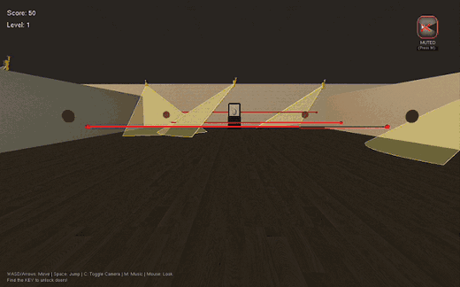
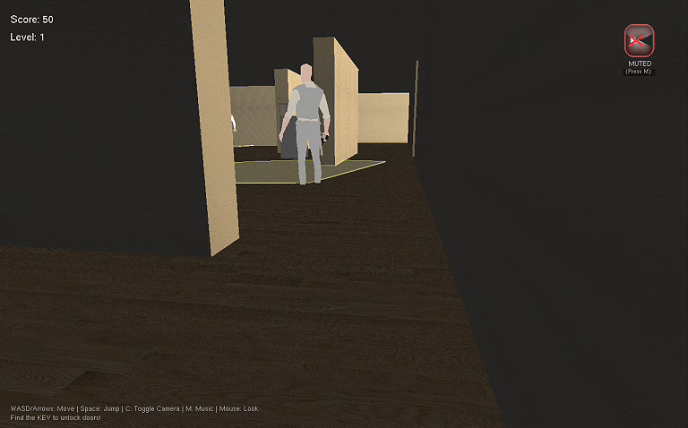
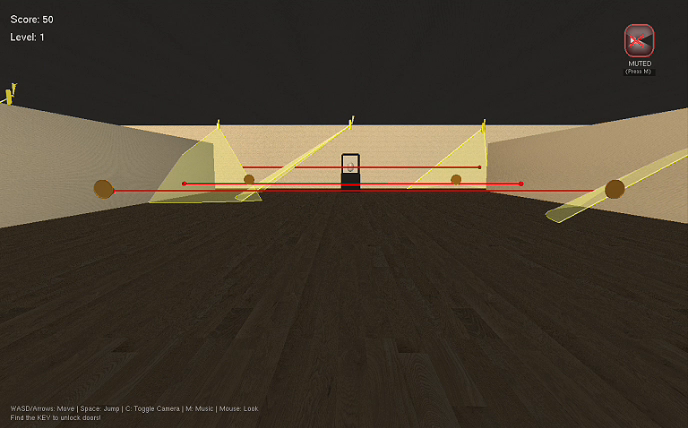
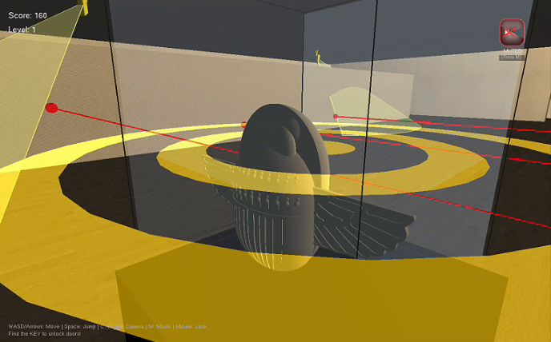
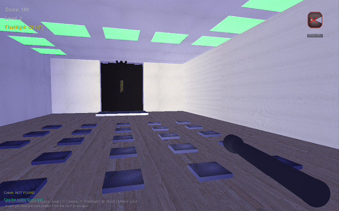
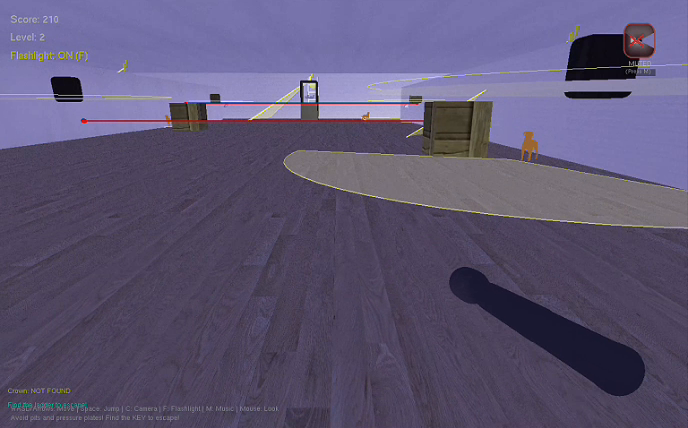
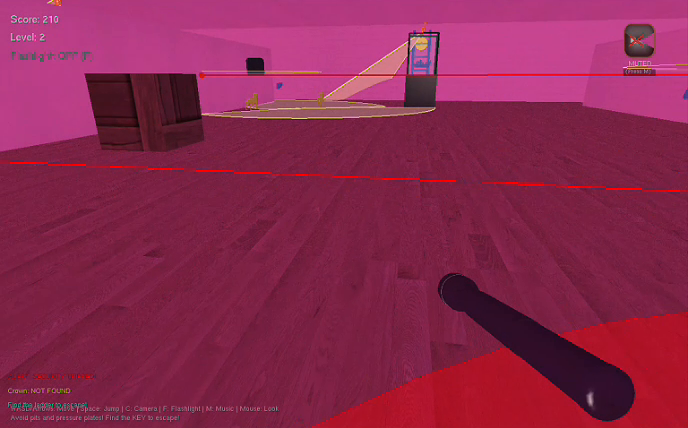

<div align="center">

# 🏺 Stealy Neal: The Golden Scarab

**A 3D stealth heist game written in C++ with OpenGL and GLUT. Sneak through a museum by day to steal the Golden Scarab, then escape from the vault at night with the Crown Jewels.**

[](https://github.com/DanEhab/stealy-neal-golden-scarab/actions/workflows/build.yml)




</div>

---

## The game

You are Neal, a thief with two jobs to do in one night. Each level has two rooms, and each room tests a different kind of stealth.

### Level 1: the museum by day

| | | |
|:---:|:---:|:---:|
|  |  |  |
| A guard patrolling the maze | Laser grids and sweeping cameras | Stealing the Golden Scarab |

- **The maze.** Three security guards patrol between waypoints. If a guard sees you, the game is over. Bump into one and you are knocked back, the camera shakes and you lose 15 points. Find the key to open the door to the exhibition hall.
- **The Egyptian wing.** Five cameras sweep the floor with their vision cones and three laser grids cross the hall. If you are spotted, you go back to the entrance of the hall, red alarm lights come on, and the first time it happens the coins you have not picked up yet disappear.
- **The Golden Scarab** waits in a glass display case at the end of the hall. When you take it, it rises out of the case in a golden glow, and the night level begins.
- The ceiling lights slowly dim from daylight to evening while you play.

### Level 2: the vault by night

| | | |
|:---:|:---:|:---:|
|  |  |  |
| The safe path glows on the ceiling | Guard dog, cameras and lasers | Alarm! The Crown Jewels at the back |

- **The pressure plates.** The floor is a 5 × 5 grid of plates, and only nine of them form a safe path. Step on any other plate and it explodes. Your flashlight (<kbd>F</kbd>) is a spotlight that follows where you look, and while it is on, the safe path glows on the ceiling. A second key at the end opens the vault door.
- **The vault.** Three guard dogs patrol and bark when you get close. Three cameras, four motion sensors pulsing red, two laser grids and four pits stand between you and the Crown Jewels, and four diamonds lie around the room. If you are caught or fall into a pit, you go back to the vault door and the red emergency lights stay on.
- **The Crown Jewels** sit in a display case under a spotlight that circles them and cycles through colours. Take them, then climb the ladder to escape over the roof.

### Controls

| Key | Action |
|---|---|
| <kbd>W</kbd> <kbd>A</kbd> <kbd>S</kbd> <kbd>D</kbd> or arrow keys | Move |
| Mouse | Look around |
| <kbd>Space</kbd> | Jump |
| <kbd>C</kbd> | Switch between first-person and third-person view |
| <kbd>F</kbd> | Flashlight on and off (level 2) |
| <kbd>M</kbd> | Music on and off |
| <kbd>H</kbd> | Show the player's collision box |
| <kbd>R</kbd> | Restart the level after you are caught, or play again after you win |
| <kbd>Esc</kbd> | Quit |

### Score

| | Points |
|---|---:|
| Key | +50 |
| Coin or diamond | +10 or +15 |
| Golden Scarab, Crown Jewels | +100 each |
| Escaping up the ladder with the Crown Jewels | +50 |
| Bumping into a guard | −15 |

## How it works

Everything is drawn with the OpenGL fixed-function pipeline through GLUT, in a full-screen window.

- **Camera.** First-person and third-person views with mouse look (the pointer is kept at the centre of the window), plus a camera shake when a guard hits you.
- **3D models.** [`ModelLoader.h`](game/ModelLoader.h) is a small OBJ/MTL loader written for the game: it reads vertices, texture coordinates, normals, faces and the diffuse colour of each material. [`ModelResourceManager.h`](game/ModelResourceManager.h) loads each of the 15 models once at start-up and shares it between all the objects that use it.
- **Textures.** [`TextureLoader.h`](game/TextureLoader.h) loads 24-bit BMP files for the floor, the walls, the crates and metal surfaces.
- **Lighting.** [`Lighting.h`](game/Lighting.h) animates up to four OpenGL lights: the day-to-evening dimming in the museum; in the vault, a dark blue ambient light, the flashlight, the red alarm lights and the colour-cycling spotlight that circles the Crown Jewels.
- **Animation.** Coins and diamonds spin and shrink when you collect them, doors swing open when you have the key, the targets levitate and glow, guards and dogs walk their patrol routes, cameras sweep from side to side and motion sensors pulse.
- **Sound.** Sound effects and looping background music play through the Windows MCI API (`mciSendString`) in [`SoundPlayer.h`](game/SoundPlayer.h).

## Run it

### Download

The [Build workflow](https://github.com/DanEhab/stealy-neal-golden-scarab/actions/workflows/build.yml) compiles the game on Windows and packages it with its models and sounds as `StealyNeal-Windows.zip`, which it attaches to every [release](https://github.com/DanEhab/stealy-neal-golden-scarab/releases). Unzip it and run `StealyNeal.exe`. The game is Windows only.

### Build from source

1. Install Visual Studio with the **Desktop development with C++** workload.
2. Open [`game/OpenGL3DTemplate.sln`](game/OpenGL3DTemplate.sln). The project was made with Visual Studio 2026 (platform toolset v145). In Visual Studio 2022, accept the prompt to retarget it to v143, or right-click the project and choose **Retarget Projects**.
3. Choose **Debug** or **Release** and **x86**, then press <kbd>F5</kbd>.

The game loads its models and sounds from paths relative to the `game` folder, which is the working directory when you start it from Visual Studio. GLUT (`glut.h`, `glut32.lib` and `glut32.dll`) is included in the same folder.

### Background music

The game plays *The Pink Panther Theme* in the background. The song is copyrighted, so it is not in this repository: put an MP3 named `The Pink Panther Theme Music.mp3` in the `game` folder (or next to `StealyNeal.exe`) to hear it. Without it the game prints a message in the console and plays only the sound effects.

## Project structure

```text
game/
├── OpenGL3DTemplate.sln, .vcxproj   Visual Studio project (Win32)
├── OpenGL3DTemplate.cpp             Entry point: window, input callbacks, loading the models and sounds
├── GameManager.h                    Game states, level changes, collisions and detection, scoring
├── Level.h                          The museum and the vault: layout, guards, devices, collectibles
├── GameObject.h                     Walls, doors, keys, collectibles, targets, pits, ladder, guards and dogs
├── SecurityDevices.h                Cameras, laser grids, motion sensors, pressure plates
├── Player.h                         Movement, jumping, collisions, the flashlight model
├── Camera.h                         First- and third-person camera, mouse look, camera shake
├── Lighting.h                       Animated lights for both levels
├── Renderer.h                       HUD, game-over and victory screens
├── ModelLoader.h                    OBJ/MTL loader
├── ModelResourceManager.h           Loads each model once and shares it
├── TextureLoader.h                  BMP texture loader
├── SoundPlayer.h                    Sound effects and music
├── Vec3.h                           3D vector maths
├── glut.h, glut32.lib, glut32.dll   GLUT for Windows
├── *.wav                            Sound effects
└── models/                          3D models (.obj and .mtl) and textures (.bmp)
docs/                                Screenshots, the gameplay GIF and the original game proposal
```

## Notes

- The 3D models, textures and sound effects are free assets downloaded from the internet and belong to their creators. Most models were converted to OBJ with [ImageToStl.com](https://imagetostl.com).
- `fall_scream.wav`, which the game plays when you fall into a pit, was never added to the project, so falling is silent.
- The screenshots and the GIF are taken from the video the team recorded of the finished game.
- The game design the team proposed before building the game is in [`docs/proposal.md`](docs/proposal.md).
- The first commit holds the game as it was submitted in December 2025. After that, only the Release configuration of the project was fixed (it had no include and library paths for GLUT) so that GitHub Actions can build a version that runs without Visual Studio.

---

## Team & course

Built for **Computer Graphics (DMET 502)** at the German University in Cairo, Winter 2025 (Prof. Dr. Rimon Elias).

Developed by **Daniel Ehab** and **George Amgad**, in team T19 with Ahmed Mostafa and Ali Hesham Abdelhady.
